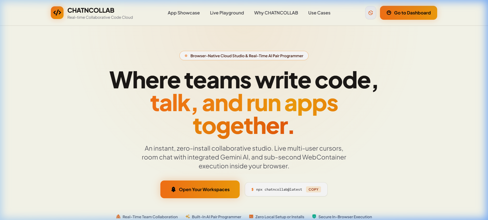
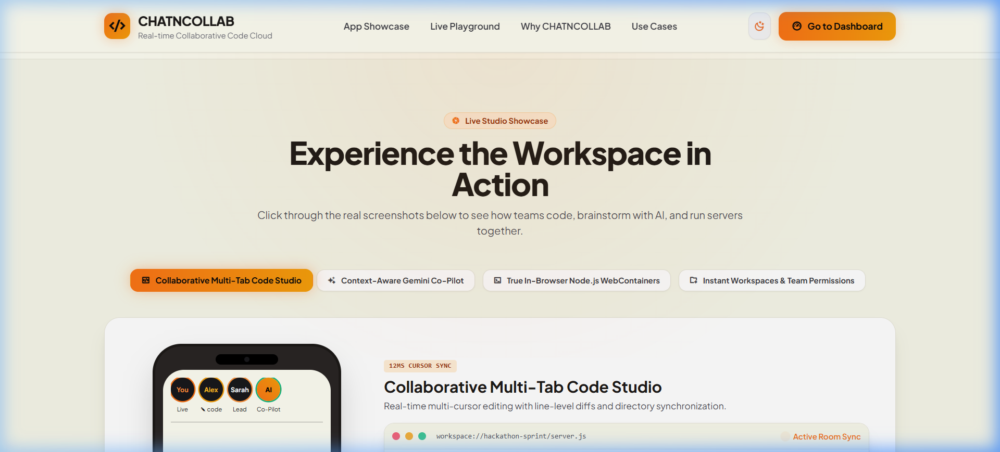
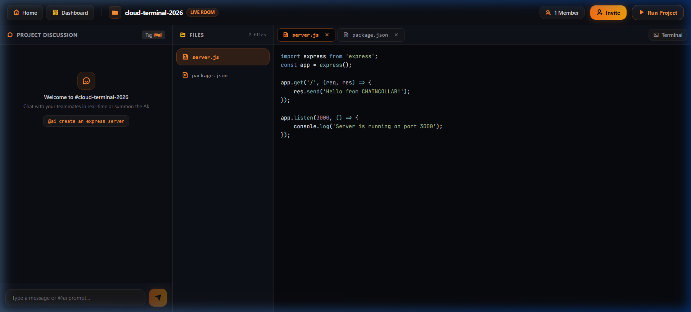
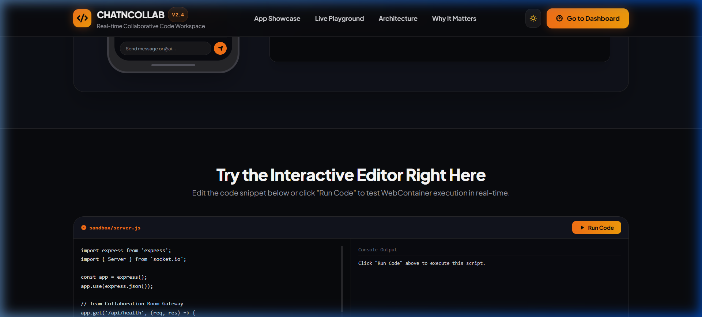
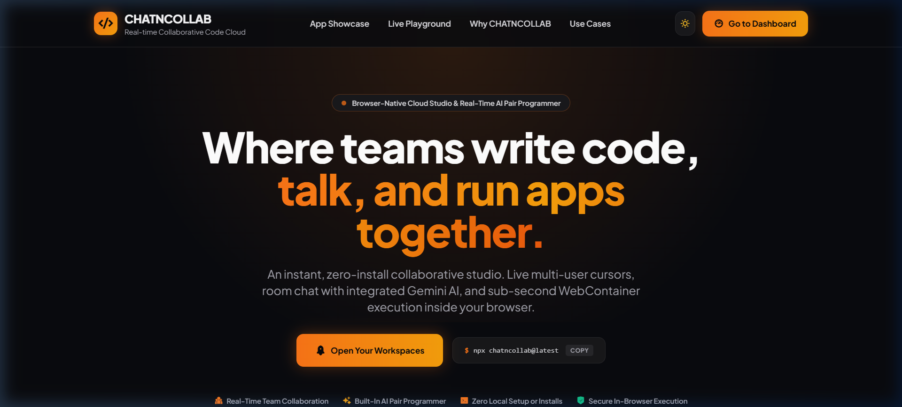
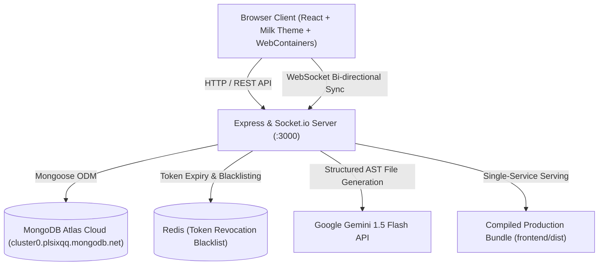

# 🚀 CHATNCOLLAB

> **Real-time Collaborative Code Cloud, In-Browser Terminal & AI Pair Programming Studio**

[](https://www.mongodb.com/atlas)
[](https://react.dev/)
[](https://nodejs.org/)
[](https://expressjs.com/)
[](https://tailwindcss.com/)
[](https://webcontainers.io/)
[](https://aistudio.google.com/)

---

## 🌐 Live Deployment & Demo

- **Live Application URL**: [https://chatncollab.onrender.com](https://chatncollab.onrender.com) *(or run via 1-click Render blueprint)*
- **GitHub Repository**: [https://github.com/SravikaPadakanti/CHATNCOLLAB](https://github.com/SravikaPadakanti/CHATNCOLLAB)
- **Database Status**: 🟢 **Online & Connected** (MongoDB Atlas Cloud M0 Cluster: `cluster0.plsixqq.mongodb.net`)
- **Theme**: Warm Milk (`#fdfdf1`) & Radiant Orange (Zero purple/blue, dual light/dark toggle)

---

## 📸 Product Showcase & Screenshots

### 1. Editorial Light Mode Homepage (Milk `#fdfdf1` & Orange)
*Zero-clutter marketing landing page built from the user's point of view.*


---

### 2. Instagram-Style Interactive Studio Showcase
*Realistic dual-device frame: mobile team stories + macOS studio window with interactive screenshot tabs.*


---

### 3. Real-Time Collaborative IDE Studio
*Multi-tab code editor, real-time file tree explorer, in-browser Node.js WebContainer terminal, and integrated team chat.*


---

### 4. User Workspace Dashboard
*Instant project search, workspace metrics, team member lists, and one-click project creation modal.*


---

### 5. Obsidian Charcoal Dark Mode
*Sleek obsidian theme (`#090a0e`) with glowing amber and orange accents.*


---

## ✨ Key Features

### ⚡ True Multiplayer Real-Time Coding
- Multi-user cursor synchronization with room-based WebSocket channels.
- Live file tree mounting and atomic updates persisted to MongoDB Atlas.
- Integrated sidebar chat with instant teammate mentions.

### 🤖 Built-In AI Pair Programmer (`@ai`)
- Mention `@ai <prompt>` anywhere in your project chat.
- Powered by Google Gemini 1.5 Flash to automatically generate multi-file boilerplates, route handlers, unit tests, and bug fixes directly mounted into your project tree.

### 💻 Zero-Install WebContainer Runtime
- Runs genuine Node.js, npm, and dev servers inside your browser tab using client-side WebAssembly.
- Install any npm package and boot web servers without using local machine CPU or installing Node locally.

### 🎨 Curated Design System (No Purple / No Blue)
- **Light Mode**: Warm Milk (`#fdfdf1`), soft bone borders (`#e7e5d8`), and deep charcoal typography (`#1c1917`).
- **Dark Mode**: Obsidian charcoal (`#090a0e`) with glowing orange and amber highlights.
- **Theme Switcher**: Instant Sun/Moon toggle with automatic `localStorage` persistence.

---

## 🏗️ Technical Architecture



---

## 🛠️ Tech Stack

| Layer | Technologies |
|---|---|
| **Frontend** | React 18, Vite, TailwindCSS (Milk & Orange custom palette), RemixIcon |
| **Execution Engine** | WebContainers API (WebAssembly in-browser Node.js runtime) |
| **Backend** | Node.js, Express.js, Socket.io (WebSocket rooms) |
| **Cloud Database** | MongoDB Atlas (Cloud M0 Replica Set) with Mongoose ODM |
| **Caching / Sessions** | Redis / ioredis-mock (Token revocation blacklist) |
| **AI Co-Pilot** | Google Gemini 1.5 Flash (Generative AI SDK) |
| **Containerization** | Docker, Docker Compose, Multi-stage builds |

---

## 🚀 Quick Start (Local Development)

### 1. Clone the repository
```bash
git clone https://github.com/SravikaPadakanti/CHATNCOLLAB.git
cd CHATNCOLLAB
```

### 2. Install dependencies
```bash
npm run install:all
```

### 3. Start Backend & Frontend
In one terminal (Backend on port 3000):
```bash
npm run dev:backend
```

In a second terminal (Frontend on port 5173):
```bash
npm run dev:frontend
```

Open [http://localhost:5173](http://localhost:5173) in your browser.

---

## ☁️ Deployment Guide

### Option 1: 1-Click Render.com Blueprint (Free Tier)
1. Fork or push this repository to your GitHub account.
2. In the [Render Dashboard](https://dashboard.render.com), click **New +** → **Blueprint**.
3. Connect your `CHATNCOLLAB` repo. Render reads `render.yaml` and deploys both backend and frontend as a single web service.
4. Set your environment variables:
   - `MONGODB_URI`: Your MongoDB Atlas URI.
   - `USE_MOCK_MONGO`: `false`
   - `USE_MOCK_REDIS`: `true`
5. Your app will be live at `https://chatncollab.onrender.com` in ~2 minutes!

### Option 2: Docker / VPS Deployment
Run the complete stack with persistent storage via Docker Compose:
```bash
docker compose up --build -d
```
Access the application on `http://YOUR_SERVER_IP:3000`.

---

## 🔑 Environment Variables Reference

### Backend (`backend/.env`)
| Variable | Description |
|---|---|
| `PORT` | Server port (default: `3000`, auto-assigned on Render) |
| `MONGODB_URI` | MongoDB Atlas connection string |
| `USE_MOCK_MONGO` | Set to `false` for cloud MongoDB, `true` for local in-memory fallback |
| `JWT_SECRET` | Secret key for signing authentication tokens |
| `USE_MOCK_REDIS` | Set to `true` for built-in in-memory Redis session management |
| `GOOGLE_AI_KEY` | Google Gemini API key (free at [aistudio.google.com](https://aistudio.google.com)) |

### Frontend (`frontend/.env`)
| Variable | Description |
|---|---|
| `VITE_API_URL` | Backend API URL (leave empty when served from the same domain in production) |

---

## 🧪 Testing & Verification

Run the automated test suite covering authentication, database unique indexes, project queries, collaborator management, and Redis token revocation:
```bash
npm run test:db
```
*Result: 15/15 automated test suites passing.*

---

## 📄 License
This project is open source and available under the [MIT License](LICENSE).
